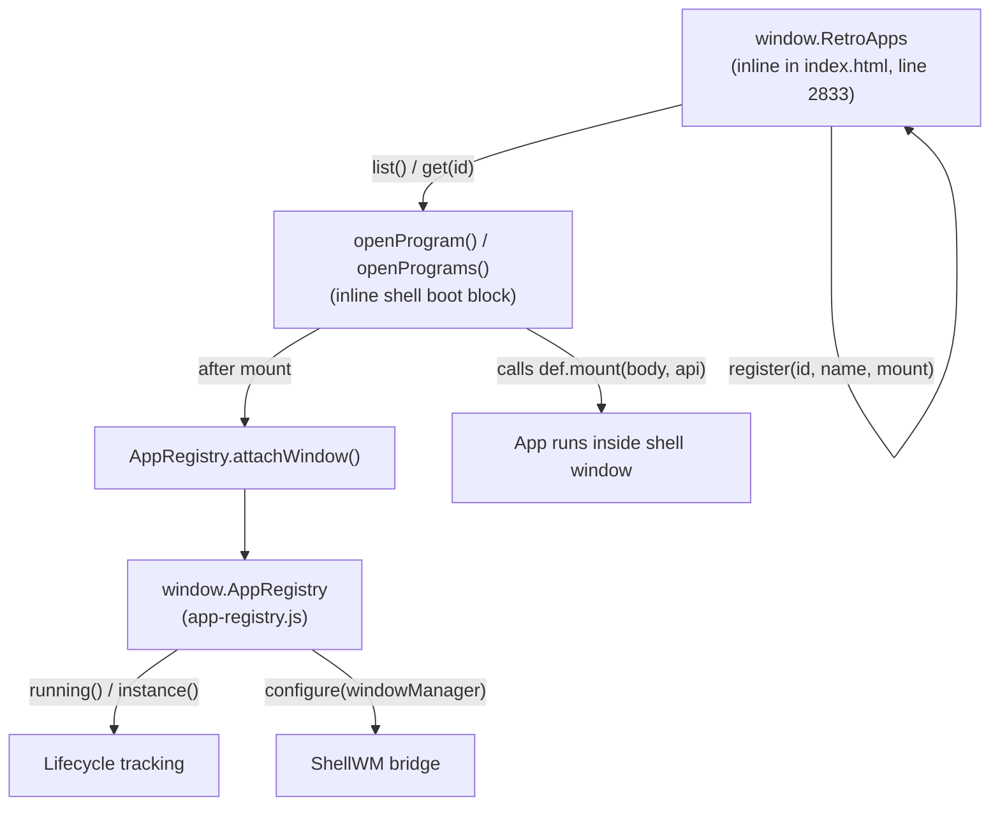
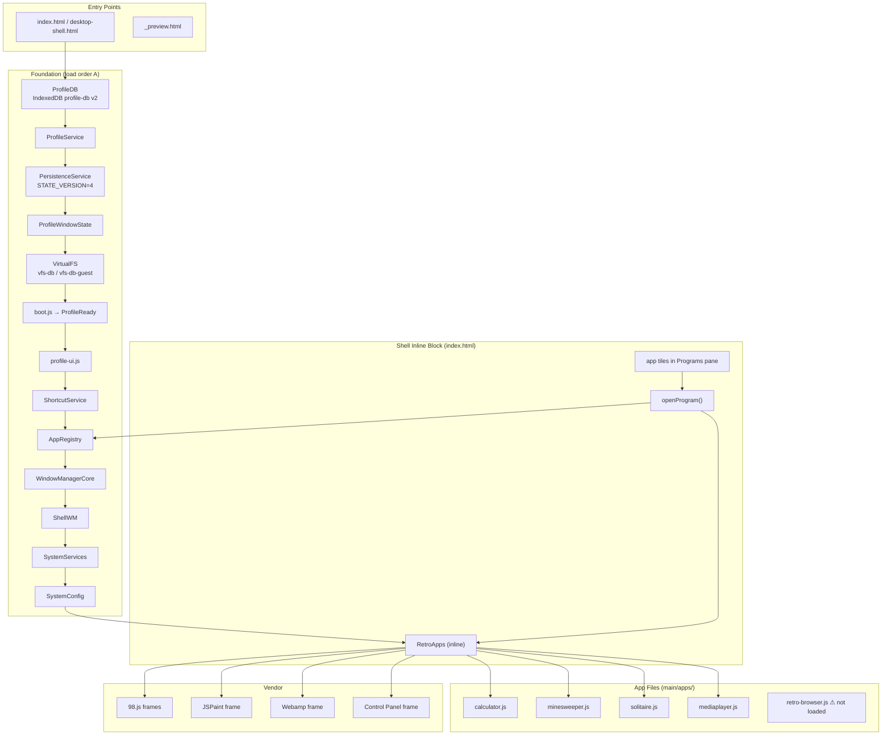

# Phase 0 Audit — x1rid.github.io Desktop Simulator

> [!IMPORTANT]
> Read-only audit. No production files were changed. All findings below reflect
> the state of the repository on 2026-10-22.

---

## 1. Repository Layout

```
x1rid.github.io/
├── main/                   ← served root (GitHub Pages uploads ./main)
│   ├── index.html          ← authoritative entry point (≈6 100 lines)
│   ├── desktop-shell.html  ← identical copy (221 055 bytes == index.html)
│   ├── _preview.html       ← alternate entry used for dev previews
│   ├── apps.js             ← RetroApps standalone manager (programs pane)
│   ├── app-registry.js     ← AppRegistry — lifecycle + running instances
│   ├── window-manager.js   ← ShellWM — snap, tiling, workspace (2 267 lines)
│   ├── window-manager-core.js ← Pure geometry, no DOM (770 lines, CJS+browser)
│   ├── shortcuts.js        ← ShortcutService
│   ├── system-services.js  ← SystemServices facade (1 421 lines)
│   ├── system-config.js    ← SystemConfig — simulated registry (1 207 lines)
│   ├── apps/               ← individual app files (5 files)
│   │   ├── calculator.js
│   │   ├── minesweeper.js
│   │   ├── solitaire.js
│   │   ├── mediaplayer.js
│   │   └── retro-browser.js
│   ├── profile/            ← profile + persistence layer
│   │   ├── profile-db.js          DB_VERSION = 2 (IndexedDB)
│   │   ├── profile-service.js     ProfileService
│   │   ├── persistence-service.js PersistenceService  STATE_VERSION = 4
│   │   ├── window-state.js        ProfileWindowState
│   │   ├── boot.js                ProfileReady promise
│   │   ├── profile-ui.js          Lock screen / login UI
│   │   └── README.md
│   ├── fs/                 ← virtual filesystem
│   │   ├── types.js, node-store.js, content-store.js
│   │   ├── path-resolver.js, events.js
│   │   ├── filesystem-service.js  VirtualFS class → window.VFS
│   │   ├── migrations.js, init.js
│   │   └── explorer-adapter.js   (67 720 bytes — largest single file)
│   ├── vendor/             ← third-party frames (98.js, JSPaint, Webamp, etc.)
│   └── …CSS files, sfx.js, terminal.js, music.js, mobile.js, …
├── tests/
│   ├── window-manager.test.js    (Node, 81 tests — ALL PASS)
│   ├── lock-screen-logic.test.js (Node, 42 tests — ALL PASS)
│   └── retro-browser.test.js     (browser smoke test, not a Node runner)
├── dora/                   ← separate PWA sub-site (unrelated)
├── imported_repos/         ← vendored sources (98.js, webamp)
└── .github/workflows/deploy.yml  ← pushes ./main to GitHub Pages
```

> [!NOTE]
> `desktop-shell.html` and `index.html` are byte-for-byte identical (both
> 221 055 bytes). The deploy workflow uploads the whole `./main` folder. Both
> filenames must remain synchronised after any HTML edit.

---

## 2. Script Loading Order (index.html)

The shell loads scripts in three ordered groups inside `<script>` tags:

### Group A — Foundation services (lines 2543–2562)
```
profile/profile-db.js          (DB_VERSION = 2)
profile/profile-service.js
profile/persistence-service.js (STATE_VERSION = 4)
profile/window-state.js
fs/types.js
fs/node-store.js
fs/content-store.js
fs/path-resolver.js
fs/events.js
fs/filesystem-service.js       → window.VFS
fs/migrations.js
fs/init.js
profile/boot.js                → window.ProfileReady (Promise)
profile/profile-ui.js
shortcuts.js                   → window.ShortcutService
app-registry.js                → window.AppRegistry
window-manager-core.js         → window.WindowManagerCore (also CJS)
window-manager.js              → window.ShellWM
system-services.js             → window.SystemServices
system-config.js               → window.SystemConfig
```

### Group B — Explorer + inline shell boot block (lines 2821–2878)
```
fs/explorer-adapter.js         → window.ExplorerAdapter
<inline script>                → window.RetroApps (inline adapter, NOT apps.js)
apps/minesweeper.js            → RetroApps.register(…)
apps/solitaire.js
apps/calculator.js
apps/mediaplayer.js
<inline script>                → vendor program registrations + openProgram()
```

### Group C — Vendor + optional
```
vendor/clippy/jquery-3.4.1.min.js
vendor/clippy/clippy.js
custom-cursor.js (defer)
```

> [!WARNING]
> **`main/apps.js` is NOT loaded by `index.html`.**  
> The file exists and defines its own full `RetroApps` implementation, but
> the shell uses a different inline `RetroApps` adapter defined at line 2833
> of `index.html`. `apps.js` appears to be an alternate/standalone version
> intended for a separate `_preview.html` or future refactor.
> This is the single biggest source of confusion in the codebase.

---

## 3. The Two Registries — Relationship Map



**Key findings:**

| Concern | RetroApps (inline) | AppRegistry |
|---|---|---|
| Authoritative for launcher tiles | ✅ Yes | ❌ No |
| Authoritative for running instances | ❌ No | ✅ Yes |
| Knows how to mount | ✅ `mount(root, api)` | ❌ delegates to launch() |
| Window creation | ❌ delegates to `openProgram()` | ❌ delegates to shell |
| Lifecycle events | ✅ `site:appchange` | ✅ `site:appopen/close/launch` |
| Duplicate prevention | ✅ id check on register | ✅ id check on register |
| Terminal's `apps` command | ✅ `RetroApps.list()` | optional |
| Search/Start | ✅ `RetroApps.list()` | N/A |

**retro-browser.js registers in BOTH**, which creates a dual-registration
pattern. Other apps (`calculator`, `minesweeper`, `solitaire`, `mediaplayer`)
only register with `RetroApps`. Explorer, Music, and Terminal are registered
only with `AppRegistry` via `attachWindow()` (no `register()` call).

---

## 4. App Mounting Contract (Current)

### RetroApps contract (programs pane)
```
RetroApps.register({
  id:      string,          // lowercase, unique
  name:    string,
  tagline: string,
  meta:    string,
  icon:    string (SVG),
  source?: string,          // e.g. 'IN-HOUSE', '98.JS'
  frame?:  boolean,         // true → iframe body class
  mount:   (root: Element, api: Api) => (() => void) | void
})

Api = {
  app:        definition,
  profile:    ProfileRecord | null,
  profileId:  string | null,
  vfs:        VirtualFS | null,
  registry:   AppRegistry | null,
  instanceId: string,
  setMeta:    (text: string) => void,
  close:      () => void
}
```

The cleanup return value is a function. The shell collects it in `win.onClose`.

### AppRegistry contract
```
AppRegistry.register({
  id:       string,
  name, tagline, meta, icon, source, kind, frame,
  fileTypes: string[],
  multiple:  boolean,
  hidden:    boolean,
  launch:    (context: Context, options: Options) => WindowObject,
  focus?:    (context, instance) => boolean,
  minimize?: (context, instance) => boolean,
  restore?:  (context, instance) => boolean,
  close?:    (context, instance) => boolean
})
```

---

## 5. Window Manager (`ShellWM`)

- **Core geometry**: `window-manager-core.js` — pure functions, no DOM,
  CJS-compatible, tested by `window-manager.test.js`.
- **Shell integration**: `window-manager.js` — requires a `bridge` object
  supplied by the inline shell via `ShellWM.init(bridge)`.
- **Bridge shape**:
  ```
  bridge = {
    windows: Map<id, WinObject>,
    desktop: Element,
    taskbar: Element,
    getActiveId: () => string | null,
    registerWindow, closeWindow, focusWindow,
    minimizeWindow, restoreWindow, …
  }
  ```
- **Win object** (internal): `{ id, appId, node, closed, minimized, maximized,
  x, y, width, height, workspace, snap, onClose, … }`

### Key lifecycle hooks called by the shell
```
ShellWM.onWindowRegistered(win, opts)
ShellWM.restoreWindowState(win, record)
ShellWM.nextZ(win)
ShellWM.beginDrag(event, win)
ShellWM.beginResize(event, win, dir)
ShellWM.toggleMaximize(win)
ShellWM.ensureVisible(win)
ShellWM.onDesktopResize()
ShellWM.snapshotState()
ShellWM.applyWorkspaceVisibility()
```

---

## 6. Persistence and Profile Storage

### Databases
| Database | Version | Stores | Owner |
|---|---|---|---|
| `profile-db` | **2** | `profiles`, `profile-state`, `system-config` | `ProfileDB` |
| `vfs-db` | — | VFS files (owner profile) | `VirtualFS` |
| `vfs-db-guest` | — | VFS files (guest profile) | `VirtualFS` |
| `vfs-db-admin` | — | VFS files (admin profile) | `VirtualFS` |

### Schema versions (DO NOT increment casually)
| Constant | Value | File |
|---|---|---|
| `DB_VERSION` (IndexedDB) | **2** | `profile-db.js` |
| `STATE_VERSION` | **4** | `persistence-service.js` |
| `SCHEMA_VERSION` (ProfileService) | **1** | `profile-service.js` |
| `SCHEMA_VERSION` (SystemConfig) | **1** | `system-config.js` |

### Profiles
```
guest  → vfs-db-guest   (no password)
owner  → vfs-db          (password-gated)
admin  → vfs-db-admin    (hidden, dev-mode only)
```

### PersistenceService.defaultState() structure (STATE_VERSION=4)
```
{
  schemaVersion, desktop, settings, apps, windows,
  shell: { pins, recentApps, taskbar, tray, network, sound },
  lockScreen, windowManager
}
```

---

## 7. Services Map

| Global | File | Public API highlights |
|---|---|---|
| `window.ProfileService` | `profile-service.js` | `init`, `unlock`, `getActiveProfile`, `subscribe` |
| `window.PersistenceService` | `persistence-service.js` | `loadProfileState`, `saveProfileState`, `queueSave`, `collectState`, `applyState` |
| `window.VFS` | `fs/filesystem-service.js` | Full virtual FS: `mkdir`, `writeFile`, `readFile`, `listDir`, … |
| `window.ShortcutService` | `shortcuts.js` | `register(spec)` → unsubscribe handle |
| `window.AppRegistry` | `app-registry.js` | `register`, `launch`, `running`, `attachWindow`, … |
| `window.RetroApps` | inline in `index.html` | `register`, `get`, `list` |
| `window.SystemServices` | `system-services.js` | `.clipboard`, `.dialogs`, `.files`, `.notifications`, `.settings`, `.events` |
| `window.SystemConfig` | `system-config.js` | `get`, `patch`, `validate`, `check`, `can`, `audit` |
| `window.WindowManagerCore` | `window-manager-core.js` | Pure geometry; also `module.exports` |
| `window.ShellWM` | `window-manager.js` | Snap/tiling/workspace |
| `window.RetroBrowser` | `retro-browser.js` (inline in index.html) | Tab + nav adapter |

---

## 8. Event Contracts (Key Events)

| Event | Emitter | Detail |
|---|---|---|
| `site:appchange` | inline shell | `{ id, name, open }` |
| `site:appopen` | AppRegistry | `{ key, appId, windowId, profileId, startedAt }` |
| `site:appclose` | AppRegistry | `+ reason` |
| `site:applaunch` | AppRegistry | `+ restoring` |
| `site:appactivate` | AppRegistry | singleton focus |
| `site:panechange` | inline shell | `{ pane }` |
| `profile:ready` | boot.js | `{ profile }` |
| `profile:changed` | ProfileService | `{ from, to }` |
| `profile:state-loaded` | PersistenceService | `{ profileId, state }` |
| `system:services-ready` | SystemServices | `{ version, vfsDb, hasVfs }` |
| `system:notification` | SystemServices | `{ level, title, message, duration }` |
| `system:clipboard-changed` | SystemServices | … |
| `system:config-changed` | SystemConfig | … |
| `node:*` | VirtualFS | file system events |

---

## 9. Existing Applications — Patterns

| App | Registration | Mount style | Uses SystemServices | Cleanup |
|---|---|---|---|---|
| Calculator | `RetroApps` only | inline HTML + event listeners | ❌ | ✅ function |
| Minesweeper | `RetroApps` only | inline HTML + timers | ❌ | ✅ function |
| Solitaire | `RetroApps` only | canvas + timers | ❌ | ✅ function |
| Media Player | `RetroApps` only | inline HTML + `<audio>/<video>` | ✅ `notifications` | ✅ function (objectURL revoke) |
| Retro Browser | `RetroApps` + `AppRegistry` | inline HTML + iframe logic | ❌ | partial (no real teardown) |
| Vendor (98.js/paint/etc.) | `RetroApps` only | iframe | ❌ | ✅ `frame.src = 'about:blank'` |
| Explorer | `AppRegistry.attachWindow` only | owned by shell | ✅ | shell-managed |
| Music | `AppRegistry.attachWindow` only | owned by shell | ✅ | shell-managed |
| Terminal | `AppRegistry.attachWindow` only | owned by shell | ✅ | shell-managed |

---

## 10. Tests — Baseline Status

| Test file | Runner | Count | Status |
|---|---|---|---|
| `tests/window-manager.test.js` | Node | **81** | ✅ All pass |
| `tests/lock-screen-logic.test.js` | Node | **42** | ✅ All pass |
| `tests/retro-browser.test.js` | Browser only | smoke | ⚠️ Not runnable in Node |

No test runner (Jest, Mocha, etc.) is installed. All tests use a hand-rolled
`ok/equal/near` harness and `vm.createContext`. This pattern is already
established and should be followed for new tests.

---

## 11. Critical Findings & Risks

### F1 — Two `RetroApps` implementations
`main/apps.js` defines a full `RetroApps` (297 lines, includes a full
launcher + window manager). `index.html` line 2833 defines a different, smaller
`RetroApps` (registers + list only; relies on `openProgram()` for windows).
`apps.js` is **not loaded by `index.html`**. The two are incompatible.
Any new framework must choose one canonical implementation and document the other
as dead code or alternate entry point.

### F2 — Dual registration in retro-browser.js
`retro-browser.js` registers with both `RetroApps` (for launcher tiles) and
`AppRegistry` (for lifecycle tracking). Its `AppRegistry.launch()` calls
`RetroApps.open()` and returns a dummy hidden `<div>` as the window object.
This is a workaround, not a proper integration. The adapter layer must
formalize this pattern.

### F3 — `openProgram()` is the real app launcher
The authoritative function that creates windows, mounts apps, and attaches them
to `AppRegistry` is `openProgram()` defined inside the inline shell block of
`index.html` (~line 4123). It is not exported as a module — it is a closure.
Any SDK must coordinate with or wrap this function, not bypass it.

### F4 — `desktop-shell.html` / `index.html` duplication
Both files are 221 055 bytes. If one is edited, the other must be updated too.
The integration framework must document this clearly and ideally provide a
check script.

### F5 — No module system, no build step
Every file uses IIFE or class in `window.*`. No bundler, no npm. Adding one
requires strong justification. The SDK must follow the same pattern.

### F6 — No retro-browser app script is loaded by index.html
`main/apps/retro-browser.js` is **not** in the script loading list in
`index.html`. The Retro Browser is instead registered by a `<script>` block
inline in `index.html` around line 3017 that registers `retro-browser` with
`RetroApps` only (no `AppRegistry` call in that inline block). The
`retro-browser.js` file registers with both registries, suggesting it was
intended as the future authoritative file but is not yet wired in.

---

## 12. Architecture Map



---

## 13. Authoritative Implementations Summary

| Concern | Authoritative location |
|---|---|
| Profile metadata + auth | `profile/profile-service.js` |
| Profile persistence | `profile/persistence-service.js` |
| Virtual filesystem | `fs/filesystem-service.js` → `window.VFS` |
| Window geometry | `window-manager-core.js` → `WindowManagerCore` |
| Snap/tiling/workspace | `window-manager.js` → `ShellWM` |
| App launcher tiles | `RetroApps` inline in `index.html` |
| Running instance lifecycle | `app-registry.js` → `AppRegistry` |
| App window creation | `openProgram()` inline in `index.html` |
| Keyboard shortcuts | `shortcuts.js` → `ShortcutService` |
| Clipboard/dialogs/notifications | `system-services.js` → `SystemServices` |
| System config (simulated registry) | `system-config.js` → `SystemConfig` |

---

## 14. Phase 1 Next Steps

Based on this audit, Phase 1 should:

1. **Define the canonical relationship** between `RetroApps` and `AppRegistry`.
   Proposal: `RetroApps` is the **display/launcher** registry; `AppRegistry`
   is the **lifecycle** registry. They are complementary, not competing.

2. **Formalize the mount API** already in use, adding optional lifecycle hooks
   (`onFocus`, `onBlur`, `onResize`, `onSuspend`, `onResume`, `getState`,
   `setState`) with explicit "only called if implemented" semantics.

3. **Create `main/sdk/app-sdk.js`** — a thin wrapper exposing the existing
   services under a stable, versioned API. No new implementations.

4. **Do NOT load `apps.js`** until its relationship to the inline
   `RetroApps` is resolved. Mark it clearly as an alternate entry-point file.

5. **Extend `retro-browser.js`** registration to be the migration pilot
   once the adapter is stable (Phase 7).

---

*Phase 0 complete. No production files were modified.*
