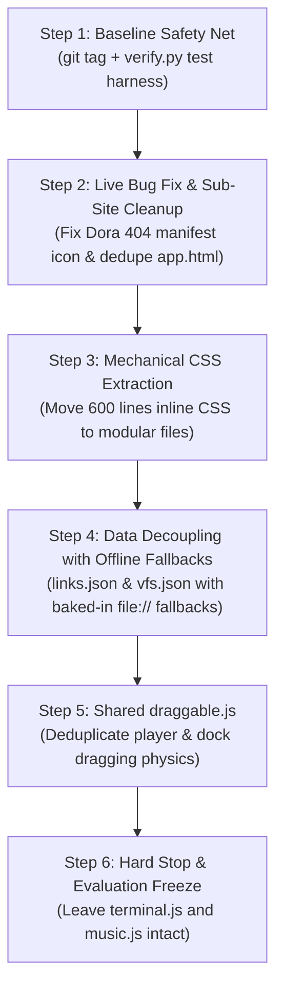

# Pragmatic Refactoring Blueprint: High-Payoff, Low-Risk Roadmap for x1rid.github.io

> **Executive Summary**: This blueprint represents the **refined, reality-checked refactoring plan** for `x1rid.github.io`. Following critical peer review, all speculative rewrites (decomposing `terminal.js`/`music.js`, converting to ES modules that break `file://`, and adding intrusive visual chrome) have been **definitively rejected**. 
>
> Instead, this plan executes **only the high-payoff, low-risk architectural improvements**: fixing an active production 404 bug, extracting 600 lines of inline CSS, providing automated static verification, isolating link/VFS data with offline fallbacks, and deduping window dragging physics.

---

## 1. The Reality Check: What We Are NOT Doing (And Why)

Before detailing the plan, we explicitly lock down what will **not** be touched to protect the codebase from regressions and maintain the site's intentional, restrained aesthetic:

```
┌────────────────────────────────────────────────────────────────────────┐
│                        Explicit Non-Goals (Rejected)                   │
├────────────────────────────────────────────────────────────────────────┤
│ ❌ NO Decomposing `terminal.js` (1,575 lines): High regression risk     │
│    (history, VFS traversal, pager, .terminal-output:empty layout math) │
│    with virtually zero payoff for a solo personal static site.         │
│ ❌ NO Decomposing `music.js` (1,254 lines): Audio breaks silently;      │
│    autoplay unlock, crossfades, and clamp math are delicate.           │
│ ❌ NO Native ES Modules (`<script type="module">`): Breaks offline      │
│    `file://` double-click access via CORS and severs the global bridge │
│    between `terminal.js` (window.showPane) and `mobile.js`.            │
│ ❌ NO CRT Scanlines Overlay ON by default: Adds GPU compositing cost    │
│    and muddies 13px carefully aligned monospace text.                  │
│ ❌ NO Random Visualizer Modes: Violates the explicit decision to keep   │
│    the music interface stable and predictable.                         │
│ ❌ NO Per-click sound effects or particle bursts: Unnecessary noise.    │
└────────────────────────────────────────────────────────────────────────┘
```

---

## 2. Verified Codebase Audit & Live Issues

Every item below has been factually verified against the current repository state:

| Component | Status / Metric | Diagnosis |
| :--- | :--- | :--- |
| **`dora/manifest.json`** | **LIVE 404 BUG** | Points to `../assets/windows-xp/logo.svg`. The root `assets/` directory was deleted in a past commit. The PWA install icon 404s in production right now. |
| **`dora/` Sub-site** | Duplicate code | `app.html` (23.6 KB) and `index.html` (25.4 KB) are divergent copies of the same attendance tracking PWA. |
| **`main/index.html`** | 767 lines | Lines 13–613 contain a massive **600-line inline `<style>` block** that clutters the HTML shell. |
| **`main/link-exchange.js`** | 152 lines | Hardcodes the entire `LINKS` array and icon scale dictionary in the middle of executable DOM rendering logic (line 8). |
| **`main/terminal.js`** | 1,575 lines | Hardcodes `const vfs` at line 20. Exposes `window.showPane` and `window.runCommand` at lines 1569–1571. |
| **`main/mobile.js`** | 98 lines | Uses `innerHTML`, `insertBefore`, and `cloneNode(true)` at runtime to transplant the title and navigation into the sidebar. |
| **Window Dragging** | Duplicated logic | Window drag/clamp/persist logic exists in both the music player window and the dock. |

---

## 3. The 5-Step Pragmatic Roadmap

This sequence is ordered strictly from **lowest risk & highest payoff** to moderate complexity, with an automated test harness installed first.



---

### Step 1: Baseline Safety Net & Automated Validator (`verify.py`)
- **Objective**: Create an instant rollback point and an automated, zero-dependency Python verification script.
- **Actions**:
  1. Create git safety tag: `git tag baseline-pre-refactor`.
  2. Author `verify.py` (~80 lines of standard-library Python, no pip requirements):
     - Parses all `.json` files in the repository to guarantee valid syntax.
     - Scans `links.json`, `playlist.json`, and manifests to verify every referenced icon, image, and `.opus` file exists on disk (catches 404s in 1 second).
     - Runs `node --check` across all `.js` files if Node is available.
- **Verification Gate**: `python verify.py` exits with code 0 (except identifying the known Dora 404).

---

### Step 2: Fix Live Dora 404 Bug & Sub-Site Hygiene
- **Objective**: Eliminate the only active production 404 error and retire redundant files.
- **Actions**:
  1. In `dora/manifest.json`, replace `"../assets/windows-xp/logo.svg"` with `"./dora.webp"`.
  2. Inspect `dora/app.html` against `dora/index.html`. Merge any unique polish into `dora/index.html`.
  3. Replace `dora/app.html` with a meta-refresh redirect to `./index.html` (or delete if unreferenced).
  4. Remove `dora/app-manifest.json`.
- **Verification Gate**: `python verify.py` reports 0 missing assets. Opening `http://localhost:5500/dora/index.html` shows valid PWA manifest icon in DevTools.

---

### Step 3: Mechanical CSS Extraction (Preserving Cascade Order)
- **Objective**: Reduce `main/index.html` from 767 lines to ~160 lines by extracting the 600-line `<style>` block into external stylesheets.
- **Safety Invariant**: Zero JavaScript files are touched. Extraction must strictly preserve the original CSS declaration order to prevent cascade specificity regressions.
- **Partitioning**:
  - `main/css/variables.css`: `:root` color tokens and dimensions (lines 17–36).
  - `main/css/base.css`: Reset, `html`, `body`, custom scrollbars, and `a` styling (lines 41–68).
  - `main/css/layout.css`: `.geocities-container`, `.layout-grid`, `.sidebar`, and `.panel-splitter` (lines 72–80, 235–350).
  - `main/css/marquee.css`: `.marquee-top`, `.marquee-track`, and `@keyframes retro-marquee` (lines 85–130).
  - `main/css/links.css`: Link exchange category tabs, grid, and `.social-tile` rules (lines 350–612).
- **Verification Gate**: `main/index.html` contains 0 inline CSS. Site is visually pixel-identical when served via `serve.py`.

---

### Step 4: Data Decoupling with Guaranteed Offline Fallbacks (`file://` Safe)
- **Objective**: Allow humans and AI agents to add links or modify VFS entries via clean JSON without risking JavaScript syntax breakage, while **preserving 100% offline `file://` compatibility**.
- **The `file://` Safety Protocol**:
  - Browsers block `fetch('./data/links.json')` when opened directly via `file://`.
  - *Solution*: `link-exchange.js` attempts to `fetch('./data/links.json')`. If the fetch fails (offline, `file://`, or network error), it immediately falls back to an inlined default array:
    ```javascript
    async function loadLinks() {
        try {
            const res = await fetch('./data/links.json');
            if (res.ok) return await res.json();
        } catch (_) {
            /* file:// or offline fallback */
        }
        return FALLBACK_LINKS;
    }
    ```
  - Same pattern applied to `vfs.json` in `terminal.js`.
- **Verification Gate**: Link tiles and terminal directory listing (`ls`/`dir`) work both when served via `python serve.py` AND when `index.html` is opened directly via `file:///`.

---

### Step 5: Shared Draggable Utility (`draggable.js`)
- **Objective**: Consolidate the two separate dragging and boundary-clamping implementations (player window and dock) into one reusable module.
- **Actions**:
  1. Create `main/draggable.js` (~80 lines).
  2. Expose a simple helper: `makeDraggable(element, handle, options)`.
  3. Wire both the retro music player window and dock to use this shared utility.
- **Verification Gate**: Music window and dock drag smoothly, clamp within viewport bounds, and persist position to `localStorage`.

---

### Step 6: Hard Stop & Evaluation Freeze
- **Objective**: Prevent scope creep and protect codebase stability.
- **Rules**:
  1. **Do NOT split `terminal.js`**. Keep the working 1,575-line file intact.
  2. **Do NOT split `music.js`**. Keep the working 1,254-line file intact.
  3. Live with the cleaned-up codebase. Evaluate whether any further changes are actually needed based on real maintenance pain rather than architectural theory.

---

## 4. Quantitative Scorecard: Before vs. After Pragmatic Plan

| Metric | Before | After Pragmatic Plan | Impact |
| :--- | :--- | :--- | :--- |
| **Production 404s** | 1 (`windows-xp/logo.svg`) | **0** | **Live bug eliminated** |
| **`index.html` Inline CSS** | 600 lines | **0 lines** | Clean, readable HTML shell |
| **`index.html` Total Lines** | 767 lines | **~160 lines** | **-79% reduction** |
| **Adding a Social Link** | Edit executable JS | Edit `data/links.json` | Zero JS syntax breakage risk |
| **`file://` Offline Support** | 100% functional | **100% functional** | Zero CORS breakage |
| **Automated Testing** | Manual inspection only | `python verify.py` | Full asset & syntax check in 1 sec |
| **Duplicated Drag Code** | 2 copies | **1 shared module** | Clean, DRY physics |
| **Regression Risk** | High (if rewriting JS) | **Near zero** | High-risk files left untouched |
| **Dependencies Added** | Zero | **Zero** | 100% static GitHub Pages compliant |

---

## 5. Execution Readiness

This refined plan respects the codebase as it actually exists, eliminates the one real production bug, simplifies styling and data management, and avoids risky rewrites.

Whenever you are ready, we can begin with **Step 1: Git Tag + `verify.py`** and **Step 2: The Dora 404 Fix**.
